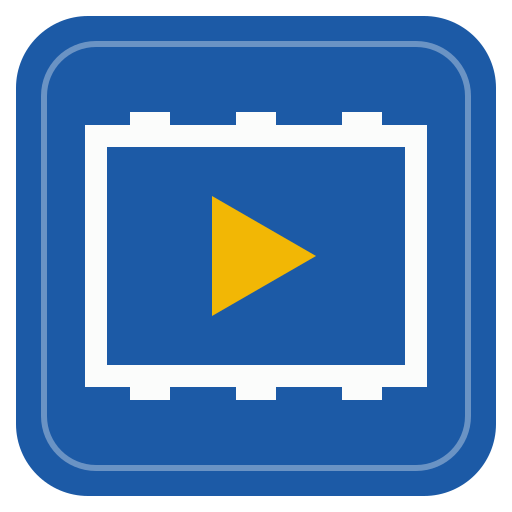

# Vid Sync



A desktop app (Windows first, Linux kept portable) that keeps a library of YouTube videos, by channel, playlist and creator, up to date with yt-dlp.

- **Add a channel, playlist or video by its link.** Paste one link or many (anywhere in the window, or press N). A channel is listed and followed; a playlist too; a single video goes into its channel's folder. Each link is read as you type, and anything already in the library is pointed out.
- **Downloads with yt-dlp**, run as a separate program that the app finds, fetches or updates for you (Settings → Tools), with ffmpeg beside it when you want video and audio merged above 720p. Quality (best, 1080p, 720p, audio only), subtitles and which tabs to follow (videos, shorts, live streams) are set per source, with library defaults.
- **New videos on a schedule.** Every followed source is checked every day by default (hourly to weekly, or by hand; per source too). A channel added with "New videos from now on" downloads only what it publishes after that; "Every video" takes the lot; "Only list them" fills the audit without downloading. Activity shows the download in hand (with Stop), what's waiting and what each check found.
- **An audit of what's missing.** For every source, what YouTube lists against what the library keeps: kept, missing, failed (with yt-dlp's reason: members only, private, age restricted…), not wanted, skipped, gone. Any listed video can be fetched or skipped on purpose from the source's Audit tab, and the Audit page totals it all.
- **Organised in several ways.** Videos by channel, by playlist (in the playlist's order), by creator (your own grouping of channels, such as a person with several of them), by tag and by search; cards or a list, sorted by published, downloaded, title, channel, length or size.
- **Watching.** The player carries on where you stopped; videos are marked watched, with a Continue watching row and a Not watched yet filter. Ctrl or Shift and click chooses several videos to mark, tag or delete together. A channel can keep only its newest videos, or let watched ones go after a while.
- **Find things.** Search looks inside subtitles and descriptions too, and jumps the player to the second something is said; any filter and search can be saved to the menu; a source can keep the top comments with each video.
- **A page for each video**: played in the app (seeking works), description with clickable timestamps, chapters, views, length, resolution, file details and your tags; and a page for each channel or playlist with its videos, audit, follow settings, creator, tags and notes.

The design and the plan are in [docs/PLAN.md](docs/PLAN.md). The stack and look follow [Repo Sync](https://github.com/DrFlGd/Repo-Sync), [Model Library](https://github.com/DrFlGd/Model-Library) and [SCAD Workshop](https://github.com/DrFlGd/SCAD-Workshop): a Rust core, a Tauri 2 window, a Preact page with no build step, the Drafting Sheet skin.

## The library folder

```
Vid Sync/                                 (~/Vid Sync until you choose another folder)
  _library/library.json                   the library's id, name and settings (schedule, defaults for new sources)
  youtube.com/channels/@handle/
    channel.json                          details, follow settings, creator, tags, notes, what's listed upstream
    avatar.jpg
    videos/2026-03-01 Title [videoid]/    one folder per video, describing itself:
      video.json                          the video's record: title, dates, size, quality, your tags, watched
      Title [videoid].mp4                 the media, its .info.json, thumbnail and subtitles beside it
  youtube.com/playlists/PLxxxx/
    playlist.json                         details, follow settings, the ordered list of its videos (kept in their channels)
```

Everything the app shows comes from these files, so the folder can be moved, synced or opened on another computer. Cookies for YouTube (when needed) and tool paths stay on this computer, never in the library.

## Status

Version 0.4. Installers are on the [releases page](https://github.com/DrFlGd/VidSync/releases) once CI publishes one (Windows: the `-setup.exe`, unsigned, so SmartScreen asks once; yt-dlp is included).

Checks run while the app runs: closing the window leaves it in the tray, and Settings can start it at sign-in. Without the app, `vidsync-cli check-all` can be scheduled instead (Windows Task Scheduler, cron); it uses the same library.

## Building

- `desktop/core`: the Rust core (`vidsync-core`, and `vidsync-cli`). `cargo test -p vidsync-core` in `desktop/`.
- `web/`: the interface (Preact + htm, no build step).
- The app: `python3 tools/build_desktop.py --out build/desktop`, `python3 tools/fetch_tools.py` (yt-dlp for the bundle), then `npx @tauri-apps/cli@2 build` in `desktop/`.
- The acceptance test (the page against the real backend and a stand-in for yt-dlp, in Chromium): `python3 tests/desktop_page.py --cli desktop/target/debug/vidsync-cli --ui build/desktop/ui --home /tmp/vs-home --out /tmp/vs-shots` (needs `pip install playwright`; ffmpeg makes the player part real).

CI (`.github/workflows/desktop.yml`) builds and tests the Windows app on every push and pull request and publishes a numbered release from `main`. `CHANGELOG.md` has the map of the code for whoever works on it next.

## Licence

MIT ([LICENSE](LICENSE)). Third-party code, programs and fonts are listed in [THIRD_PARTY.md](THIRD_PARTY.md). yt-dlp and ffmpeg are run as separate programs; downloading videos is subject to YouTube's terms and the rights of their creators.
